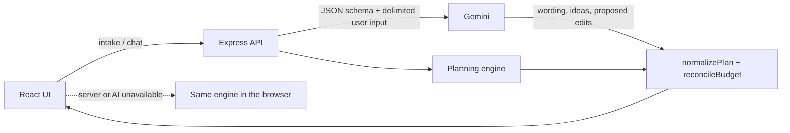

# CelebAI: event planning assistant

CelebAI helps people organize **weddings, birthdays and community events**. You enter the date, headcount, budget, venue, theme and special requirements, and it produces a complete plan: a budget split, a dated timeline, a vendor checklist and ideas. It then keeps the plan honest as things change (more guests, a smaller budget, a new date).

## Chosen vertical

**Celebration & Event Planner** (PromptWars Challenge 5): a GenAI assistant for weddings, birthdays and community events that covers budgets, timelines, vendor checklists and personalized ideas.

- **Persona:** someone organizing a celebration without professional planning experience, who needs to know *how much to spend on what, what to book first, and by when*.
- **Source:** <https://github.com/The-AlphaWolf/celebai-promptwars>
- **Static demo:** <https://the-alphawolf.github.io/celebai-promptwars/>. GitHub Pages has no API server, so the demo is built with `VITE_STATIC_DEMO=true` and runs entirely on the in-browser planning engine, with no API calls.

## Approach and logic

The design splits the work into two parts. Decisions are made by a **deterministic planning engine**. Language and creativity come from **Gemini**. Every AI output is validated and re-balanced by the engine before it reaches the screen.

| Part | Responsibility | Where |
|---|---|---|
| Planning engine (pure functions) | Budget split, contingency, schedule, vendor priorities, risk analysis, plan edits | [`src/domain/planner.js`](src/domain/planner.js), [`profiles.js`](src/domain/profiles.js) |
| Offline assistant | Turns chat requests ("reduce catering by 15%", "we now have 180 guests") into engine operations | [`src/domain/assistant.js`](src/domain/assistant.js) |
| Validation | One schema for form input, saved plans, request bodies and model output | [`src/domain/planSchema.js`](src/domain/planSchema.js) |
| API server | Keeps the Gemini key server-side, calls Gemini with JSON schemas, falls back to the engine | [`server/`](server) |
| React UI | Dashboard, dialogs, chat; works with or without the server | [`src/components/`](src/components) |

### How decisions depend on the user's context

| Context | Decision |
|---|---|
| Event type | Category mix, minimum realistic spend per guest, recommended lead time, vendor list and milestone schedule (`EVENT_PROFILES`) |
| Budget ÷ guests | Per-guest categories (food, drink, cleanup) get a larger share when money per guest is tight and a smaller one when it is generous (factor clamped to 0.75–1.5) |
| Venue or setting | Outdoor (stated, or inferred from words like *garden*, *park*, *beach*) adds a *Tents, Power & Weather Backup* line and a rental vendor, and raises the reserve by 5% (mixed setting: +3%) |
| Guest count ≥ 150 | Adds *Security & Guest Logistics* and a stewards vendor |
| Days until the event | Short notice raises the reserve by 5%. Milestones are scheduled backwards from the date and compressed proportionally when time is short. Vendors whose usual booking lead time has already passed are marked **Critical** |
| Notes | Dietary needs (vegan, gluten-free, halal, nut, allergies…) go into the caterer brief. Mentions of kids or family add a kids' activity vendor. Theme and notes keywords rank the idea library, and a free-text theme adds one idea built from its own words |
| Plan changes | Budget changes rescale all lines. Headcount changes rescale per-guest lines and take the difference from the reserve. Trims move savings into the reserve. Plans the engine creates or adjusts always sum exactly to the budget; manual edits in the table can over-allocate, and the insights panel flags it |

`analyzePlan()` checks the current plan and reports **planner insights**:
- over-allocation
- spend per guest below the realistic minimum
- reserve under 8%
- rushed timeline
- vendors not booked inside their lead time
- overdue milestones
- categories where spending exceeds the allocation

## How the solution works



1. **New plan:** `POST /api/plan` normalizes the intake and runs `generatePlan()`. If `GEMINI_API_KEY` is set, Gemini writes the summary, ideas and milestone descriptions under a response schema. Its numbers are ignored, so the engine's numbers always stand.
2. **Chat:** `POST /api/chat` sends a compact plan plus the user's message (inside `<user_input>` tags) to Gemini. A proposed edit is a patch: budget lines are matched by id (lines the model leaves out are kept), then the result is validated by `normalizePlan()` and re-balanced by `reconcileBudget()`. The user sees it as a proposal and applies it with one click.
3. **No key, Gemini error, or no server:** the same engine answers, either on the server or in the browser. Each reply is labelled with its source. Static builds (`VITE_STATIC_DEMO=true`, used for GitHub Pages) skip the API entirely.

## Assumptions made

- Amounts are in USD. Budget shares, per-guest minimums ($90 wedding, $40 birthday, $15 community) and vendor lead times are general planning heuristics, not market quotes. They live in `profiles.js` so they can be tuned.
- If no date is given, the plan assumes the recommended lead time for that event type and says so in the summary.
- Vendors are listed as roles ("Full-service caterer & bar"), not real businesses. Contacts start empty.
- Plans are saved only in the user's browser (`localStorage`). There are no accounts or server-side storage.
- One currency, one event per browser.

## Run it

Requirements: Node.js 22.9 or newer.

```bash
npm ci
npm run build
npm start              # API + built app on http://localhost:8080
```

Optional AI: copy `.env.example` to `.env` and set `GEMINI_API_KEY` (server-side only, never `VITE_`-prefixed). Without it, everything works through the planning engine.

For development, run `npm start` in one terminal and `npm run dev` in another. Vite proxies `/api` to port 8080.

Container (for example Cloud Run): `docker build -t celebai .` then `docker run -p 8080:8080 -e GEMINI_API_KEY=... celebai`.

## Testing

```bash
npm run lint            # oxlint incl. jsx-a11y rules
npm test                # vitest
npm run test:coverage   # with coverage thresholds (80% statements/lines/functions, 70% branches)
npm run check           # lint + coverage + build
```

The suite lives in [`tests/`](tests):
- **`domain/`:** budget totals for extreme budgets, headcount scaling, outdoor and large-crowd rules, timeline compression and past dates, dietary and kids rules, insights, every plan adjustment, every assistant intent, and hostile or malformed input for the validators.
- **`server/`:** security headers, 400/404/413/429 responses, engine-only mode, merging of AI output with numbers kept fixed, fallback when Gemini fails or returns junk, SPA hosting, and the Gemini wrapper with a mocked SDK.
- **`services/`:** the browser API client and its offline fallback.
- **`ui/`:** the full app in jsdom. Covers the intake flow, keyboard tab navigation, dialog focus trap with Escape and focus return, applying assistant proposals, corrupted or unavailable storage, component behaviour, and automated `axe-core` checks with and without a dialog open.
- **`utils/`:** content of the PDF export.

CI ([`.github/workflows/ci.yml`](.github/workflows/ci.yml)) runs lint, coverage, `npm audit` (production dependencies), a Docker image build and the app build on every push. It deploys Pages only after these pass.

## Security

- **No secrets in the browser.** The Gemini key is read from the server environment only. `.env` is git-ignored.
- **Validation at every boundary.** `normalizePlan()` / `normalizeIntake()` enforce types, enums, ranges, string lengths, list sizes and colour formats on form input, saved plans, request bodies and model output. Invalid plans are rejected and malformed fields repaired.
- **Prompt-injection hardening.** User text is delimited and declared as data in the system prompt, and delimiter tags are stripped from user text so it cannot close the block early. The model may only return schema-shaped JSON. Proposed numbers are re-validated and re-balanced.
- **HTTP hardening.** `helmet` sets a strict Content-Security-Policy (`script-src 'self'`, `frame-ancestors 'none'`, `object-src 'none'`) and other headers. There is also a 64 KB body limit, a per-IP rate limit (30 requests/min on `/api`) and generic error messages. `TRUST_PROXY=1` behind exactly one proxy (Cloud Run) so rate limiting sees real client IPs.
- **Safe rendering.** Assistant markdown is rendered as React elements (no `dangerouslySetInnerHTML`). A test checks that HTML in replies stays text.
- Note: GitHub Pages cannot send these headers. The CSP applies when the app is served by `server/`.

## Accessibility

- Skip link, landmarks (`header`, `main`, `aside`), one `h1` and an ordered heading structure.
- WAI-ARIA tabs with roving tabindex and Arrow/Home/End keys.
- Dialogs have `role="dialog"`, `aria-modal` and labels. Focus is trapped while they are open, Escape closes them, and focus returns to the opener.
- Every form control has a label. Icon buttons have names. The event-type picker uses real radio buttons.
- The CSS donut chart has a text alternative and a legend. Progress uses native `<progress>`. Status messages go to a polite live region.
- `prefers-reduced-motion` disables animations and confetti. Focus rings are visible.
- Theme text tokens (`--text-secondary`, `--text-muted`) measure at least 4.5:1 against every theme's canvas and card backgrounds (WCAG AA for body text). The light theme overrides the pastel badge colours used on dark themes.
- Checked automatically by oxlint `jsx-a11y` rules and `axe-core` tests on every tab in jsdom. jsdom has no layout, so contrast and other layout-dependent rules were checked by running axe-core in Chromium at 362 px and 1366 px wide, on every theme, tab, the chat panel and the intake dialog (0 violations). Axe cannot score text over gradients or translucent panels; that text was compared only approximately against each theme's solid surface colours.

## Efficiency

- The production entry bundle went from 818 kB (252 kB gzip) to about 300 kB (94 kB gzip). jsPDF (and its optional html2canvas/DOMPurify chunks), confetti, the chat panel and the intake dialog are loaded on demand.
- Plan maths is O(n) over a few dozen items and memoized in the UI.
- Prompts send a compact plan (ids, names, numbers) instead of the full plan. Each AI call has one model, one request and a 20 s timeout, then falls back to the engine. There are no retry loops.

## Project structure

```text
server/            Express API, Gemini wrapper, prompts and response schemas
src/domain/        Planning engine, profiles, validation, offline assistant, sample intakes
src/services/      Browser API client with offline fallback
src/components/    React components (each with its own CSS file)
src/hooks/         Persistent plan state
tests/             Vitest suites (domain, server, services, ui, utils)
```

## Known limitations

- No accounts or sync. A plan lives in one browser.
- Cost heuristics are generic, not regional.
- Gemini output quality depends on the model. The engine guarantees the numbers, not the prose.
